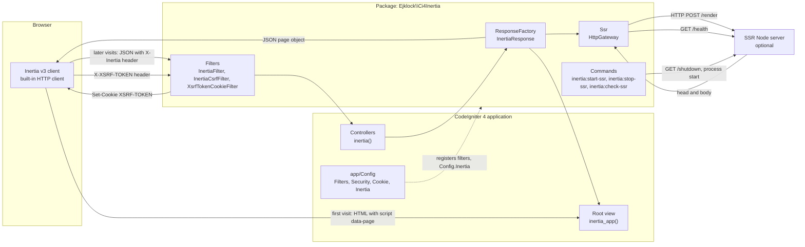

# Context

This view answers what the package talks to and over which transport: the CodeIgniter 4 application that installs it, the Inertia v3 client in the visitor's browser, and the optional SSR Node server. The package is the `Ejklock\Ci4Inertia` namespace, and it ships as one Composer package that the application requires.

The first-visit edge ends in the root view, which prints the page through `inertia_app()`: the SSR body when the gateway returned one, otherwise the `script[data-page]` tag and its mount element. Every later visit carries `X-Inertia`, and `InertiaResponse::toResponse` answers it with the page object as JSON. `XsrfTokenCookieFilter` writes the `XSRF-TOKEN` cookie on responses below 400, and the client sends it back as `X-XSRF-TOKEN`, which `InertiaCsrfFilter` checks against the session through `Config\Security::$headerName`. `StopSsr` calls `/shutdown`; `StartSsr` stops a running server first and then starts the bundle with `Symfony\Component\Process`.

## Drift instrument

Drift is caught by inspection under the no-drift rule in `AGENTS.md`: a change to a transport, a route of the SSR server or a filter alias updates this view in the same commit. The boundary between the package and the application has a deterministic instrument, `tests/Architecture/PackageDoesNotDependOnAppTest.php` (phpat), which fails when any class under `Ejklock\Ci4Inertia` depends on `App`; the arrows from the application into the package are therefore the only direction this view allows.
