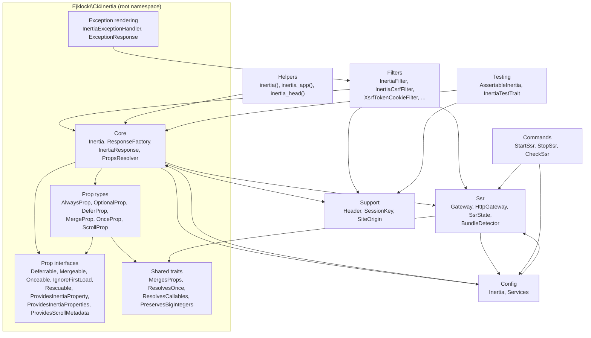

# Module layout

This view answers how `src/` divides into modules and which module depends on which, as the `use` statements show. The core sits at the root namespace `Ejklock\Ci4Inertia`; the other modules are its sub-namespaces and `src/Helpers`, which holds the global helper functions. Prop types and their interfaces share the root namespace and are drawn as their own groups to keep the core readable.

`Core` reaches `Ssr` through the `ConfiguresSsrRequests`, `DisablesSsr` and `ExcludesSsrPaths` interfaces, and reaches `Config` through `Config\Services` to find the shared factory. `Config` and `Core` depend on each other: `Services` builds the `ResponseFactory`, and `Inertia` and `InertiaResponse` ask `Services` for the shared instance. `Ssr` and `Commands` use `Config\Inertia` for the SSR options. Nothing in the package depends on the application namespace `App`.

## Drift instrument

`tests/Architecture/PackageDoesNotDependOnAppTest.php` (phpat, run with the PHPStan analysis) fails when a class under `Ejklock\Ci4Inertia` depends on a class under `App`, so that arrow cannot be drawn and cannot appear in the code. The arrows inside the package have no deterministic check; they are kept by inspection, and a new `use` between modules updates this view in the same commit.
