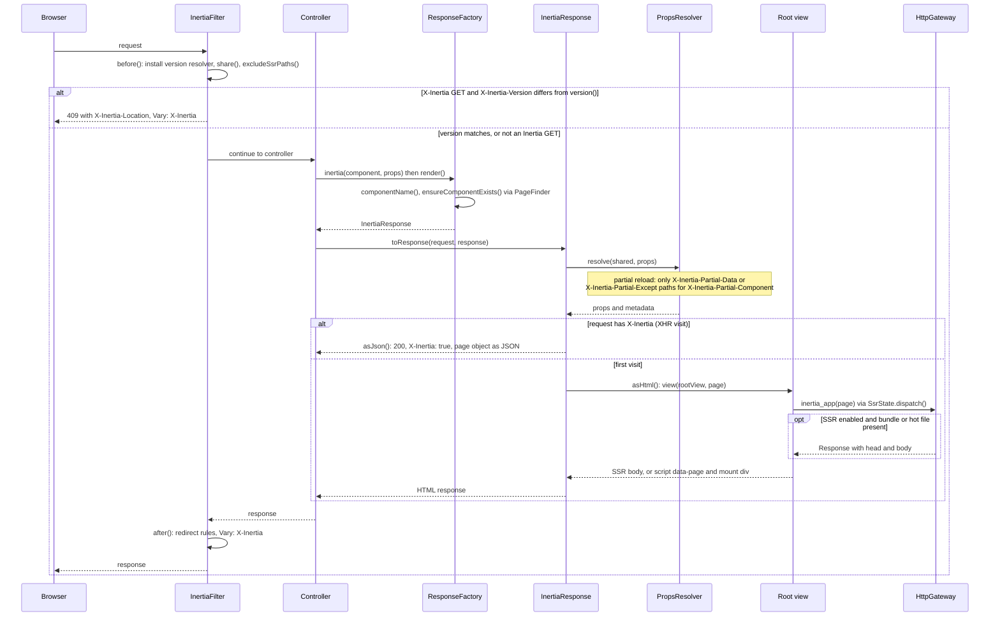

# Page visit

This view answers how one visit executes, in order, from the filter through the controller to the response, and where the first visit and an Inertia XHR visit part ways. The order is the one in `InertiaFilter::before`, `ResponseFactory::render` and `InertiaResponse::toResponse`.

On a first visit the root view prints the page through `inertia_app()`, which asks `SsrState` to dispatch the page to `HttpGateway`; when the gateway returns nothing, the helper prints the `script[data-page]` tag and the mount element. On an Inertia XHR visit no view is rendered. The `409` branch short-circuits in `before()`, so the controller never runs; a redirect to a URL with a `#fragment` produces a second kind of `409` in `after()`, which this view leaves out.

## Drift instrument

No deterministic instrument exists for this view; it is kept by inspection under the no-drift rule, and a change to the order of `before()`, `render()`, `toResponse()` or the root view hand-off updates it in the same commit. The behavior of each branch is exercised by `tests/InertiaFilterTest.php` and `tests/InertiaResponseTest.php`.
