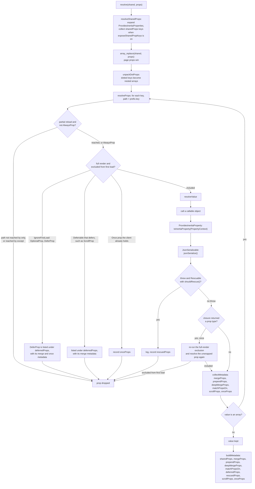

# Props resolution

This view answers how `PropsResolver::resolve` turns the shared props and the page props into the props sent and the metadata written on the page object. The steps follow `resolve()`, `resolveProps()` and `resolveValue()` in `src/PropsResolver.php`.

A partial reload counts only when `X-Inertia-Partial-Component` names the component being rendered. `AlwaysProp` bypasses the `only` and `except` filter, and so do the children of a value that was not an array before it was resolved. A rescued prop is skipped by the walk and listed under `rescuedProps`, except when a closure returned the rescuing prop: that key stays in the props as `null`. A throwable from any other prop propagates.

## Drift instrument

No deterministic instrument exists for this view; it is kept by inspection under the no-drift rule, and a change to the order of steps in `PropsResolver` or to a key of the page metadata updates it in the same commit. The behavior is exercised by `tests/PropsResolverTest.php`, `tests/InertiaFilterTest.php` and `tests/InertiaResponseTest.php`.
